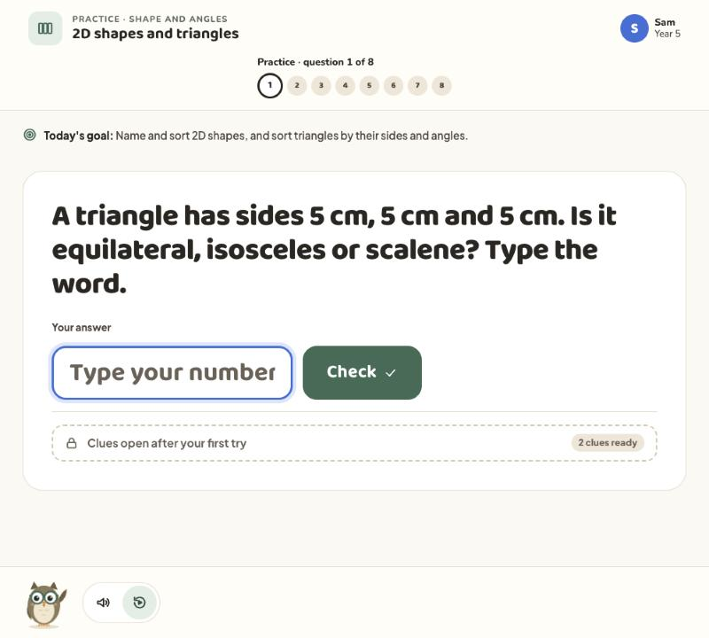
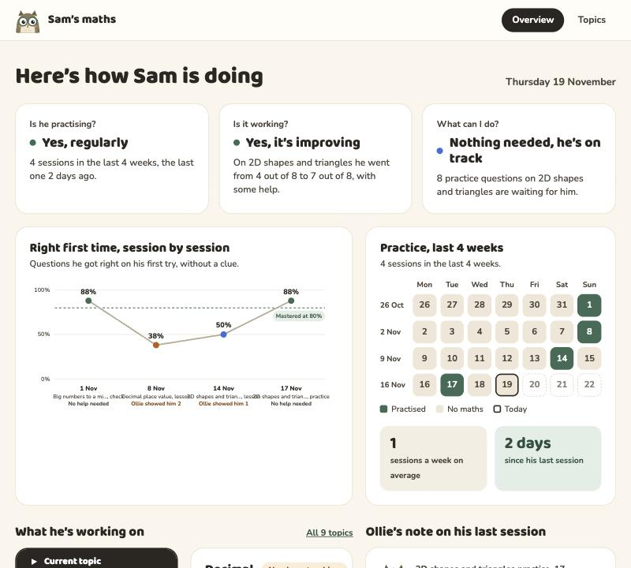
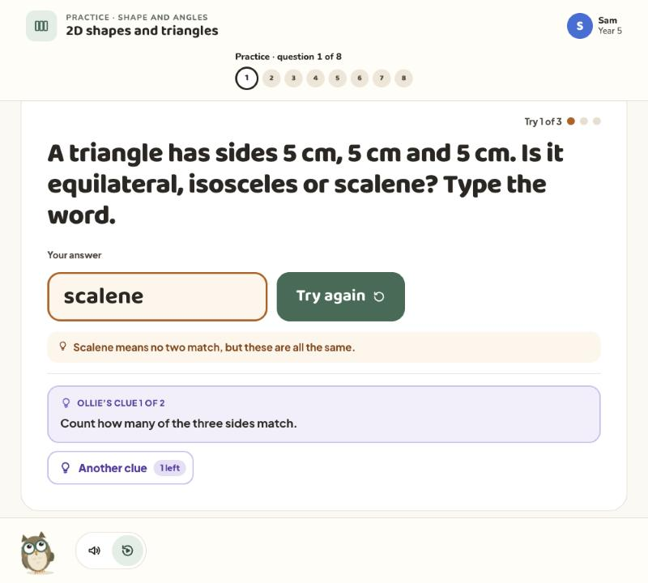

# AI Maths Tutor

A personalised maths tutoring system where an AI (Claude) acts as the tutor.
A child answers daily questions on a web page; Claude grades every answer,
writes age-appropriate feedback, and designs the next session — adapting
difficulty, tips, and focus based on what the child actually got wrong.

It is built for **one child at a time**, run by their parent, on their own
database. There is no multi-tenant mode and no hosted service.

---

## What it looks like

| The child's page | The parent's dashboard |
|---|---|
| [](docs/images/session.jpg) | [](docs/images/dashboard.jpg) |

A wrong answer never ends the question. Coach Ollie responds, the clues unlock,
and the next one opens by itself if the child is still stuck — so every question
ends in an answer rather than a dead end.



*(Screenshots show the built-in demo child, not a real one.)*

---

## See it working first

You do not need a child, a curriculum or an API key to look around — but you do
need the database connected, because that is where everything lives. So do
[step 1](#1-connect-a-database) first, then come back here.

Once `npm run check` passes, seed a demo child with a few weeks of invented
history:

```bash
node scripts/seed-demo.js            # show what it would write
node scripts/seed-demo.js --force    # write it
npm start                            # http://localhost:3000
```

`/dashboard.html` is the parent's view, `/` is the child's session page. Remove
it again with `node scripts/seed-demo.js --remove`.

The demo refuses to run if the database already holds a real child, because the
app resolves "the child" as whichever one it finds first. To preview alongside
real data, point it at a throwaway database:
`MONGODB_DB=maths-tutor-demo node scripts/seed-demo.js --force`.

---

## What you need

| | |
|---|---|
| **Claude Code** | A paid Anthropic plan. Grading, lesson writing and verification all run as Claude Code agents on your machine — this is the part that cannot be replaced by a script. Each `/grade` run costs tokens. |
| **Node 18+** | Four runtime dependencies: `express`, `mongodb`, `dotenv`, `serverless-http`. |
| **MongoDB** | Atlas's free tier is enough — permanently free, no card. Two collections. [Setup walkthrough](docs/database.md) if you have not done this before. |
| **Netlify** (optional) | Only if you want the child to use it on their own device. Local-only works fine. |
| **~500 MB disk** (optional) | Only for Coach Ollie's recorded voice. Measured: `tools/voice/node_modules` is 496 MB installed. Nothing of it reaches the deploy or the child's device. |

The scripts must run on your real machine. Claude's cloud sandboxes and VMs are
firewalled off from your database.

---

## Getting started

### 1. Connect a database

Everything the child does is stored in MongoDB — their topics, their progress,
every session. It is free and you will not be asked for a card.

```bash
npm install
cp .env.example .env
```

Now put your connection string in `.env` as `MONGODB_URI`, and check it:

```bash
npm run check
```

That command is there because this is the step people get stuck on. It tells
you in plain English whether the database answered, whether the user can write,
and if not, which of the four usual mistakes it is. It never prints your
password.

**If you have not used MongoDB before, follow
[docs/database.md](docs/database.md).** It goes from no account to a working
connection in about ten minutes, and covers the two things that catch almost
everyone: the `<db_password>` placeholder Atlas leaves in the string for you to
replace, and the fact that the database user is *not* your Atlas login.

### 2. Set the two access keys

These stop strangers reading your child's data off a public URL. Generate a
pair:

```bash
node -e "const c=require('crypto');for(const k of ['TUTOR_CHILD_KEY','TUTOR_ADMIN_KEY'])console.log(k+'='+c.randomBytes(24).toString('base64url'))"
```

Paste both lines into `.env`. There are two because the child's device has to
store its key permanently:

- `TUTOR_CHILD_KEY` — the child's page. Can only fetch the next session and
  post answers.
- `TUTOR_ADMIN_KEY` — the dashboard, curriculum edits, session deletes. Never
  put this on the child's device.

Running locally skips the check entirely, so you can ignore all of this until
you deploy; set `TUTOR_AUTH=on` to test the real behaviour. **Deployments
always enforce it.**

### 3. Create the child's profile

In a terminal, `cd` into this folder and run `claude` to start Claude Code
([install instructions](https://docs.claude.com/en/docs/claude-code/overview)).
Then type:

```
/setup-child
```

Claude asks for the child's name, age, curriculum board and stage, researches
the official framework, proposes topics in prerequisite order, and saves the
profile once you approve it. Nothing is written to the database until you say so.

### 4. Build the first session

```
/next-session
```

`/grade` is for days when there is finished work to mark. The first time, there
is nothing to grade, so `/next-session` builds the opening session directly.

### 5. Run it

```bash
npm start        # http://localhost:3000
```

`/` is the child's page, `/dashboard.html` is yours.

### 6. Coach Ollie's voice (optional)

The child's page works without it — Ollie shows his speech bubble silently.
To give him a recorded voice:

```bash
cd tools/voice && npm install
node render.js bank
```

This is a separate package on purpose: it pulls in a text-to-speech model and a
native runtime (hundreds of MB) that must never reach the deploy or the child's
device. `docs/voice.md` explains the whole pipeline.

### 7. Deploying (optional)

**Read `docs/deploy.md` before putting this on a public URL.** It covers the
Netlify environment variables, the Atlas network access rule, and the key
handling a first deploy always needs.

---

## Daily routine

1. The child does their session. Every answer posts as they go; finishing marks
   it submitted.
2. You open Claude Code in this folder and run `/grade`.
3. Claude marks every answer by working the maths itself, diagnoses the error
   patterns, writes the feedback card, and queues tomorrow's session.

A session is always written **ahead of time**, never generated while the child
waits. That means no API key on the server, no latency for the child, and you
can review what they will get before they see it.

---

## Slash commands

| Command | What it does |
|---|---|
| `/grade` | Grade the latest submitted session and queue the next one — the everyday command |
| `/next-session` | Build a session when there is nothing to grade (the first one, or after a gap) |
| `/status` | Read-only progress summary; changes nothing |
| `/setup-child` | Research a curriculum and create the child's profile |
| `/run` | Start the local dev server |
| `/reset-child` | Testing only — wipe a child's sessions and progress, keeping the approved topic list |

---

## Scripts

```bash
npm run check                                        # is the database connected? (start here)
npm test                                             # the four test suites
npm run fetch                                        # show the newest ungraded session
node scripts/seed-demo.js --force                    # demo child with history
node scripts/save-curriculum.js profiles/<id>.json   # save an approved curriculum
node scripts/verify-session.js <file>                # structural checks on a session
```

All of them talk to MongoDB directly through `scripts/db.js` and read
`MONGODB_URI` from `.env`.

---

## The AI's role

Claude does the work a human tutor would do:

- Works out the correct answer for every question before marking
- Identifies *why* an answer is wrong (stopped early, calc slip, misread, avoidance)
- Separates **completion** (got there with help) from **right first time**, and
  only ever advances a child on the second
- Writes feedback in a voice appropriate for the child's age
- Designs the next session — adjusting difficulty, scaffolding and focus
- Tracks progress across sessions and fades support as the child improves

Your job is to set up the profile, approve the curriculum, mark which topics
school has already covered, and run `/grade` after each session.

Every generated session is checked twice before it reaches the child: an
automatic answer-key check, then an independent cold re-solve by a separate
agent that never saw how the questions were written.

---

## Phases

| Phase | What happens |
|---|---|
| **1 Setup** | Parent approves curriculum topics for the child's age and board |
| **2 Placement** | AI checks school-covered topics; assigns known / partial / weak |
| **3 Learning** | Lesson → practice → check cycle for weak and partial topics |
| **4 Review** | Spaced re-test of mastered topics |

---

## Stack

- **MongoDB** — children and sessions, two collections (`scripts/db.js`)
- **Express** — the API in `app.js`; no `listen` of its own, so the same app
  serves local dev (`server.js`) and production (a Netlify Function)
- **Netlify** — `public/` as static pages, `/api/*` rewritten to one Lambda
- **Claude Code** — the tutor; runs on the parent's machine

The child's page has no build step — plain HTML with Tailwind from a CDN.

---

## Repository layout

```
CLAUDE.md                   operating manual Claude Code follows
.claude/agents/             grader, teacher, author, feedback, verifier, illustrator, curriculum
.claude/commands/           /grade, /next-session, /status, /setup-child, /run, /reset-child
app.js                      the Express app — all routes, no listen
server.js                   local dev entry point
netlify/functions/api.js    production entry point (wraps app.js as a Lambda)
docs/                       deeper reference, one file per concern
  database.md               connecting MongoDB from scratch — start here if stuck
scripts/
  db.js                     MongoDB data layer + virtual paths
  fetch-latest.js           print the newest ungraded submitted session
  save-grading.js           write marks + feedback + topicStatus + brief
  save-session.js           validate and queue the next session
  save-curriculum.js        validate and save an approved curriculum profile
  verify-session.js         structural checks before a session is saved
  check-db.js               plain-English database connection check
  seed-demo.js              demo child with history, for a first look
public/
  index.html                the child's daily session page
  dashboard.html            the parent's dashboard
  dashboard-classic.html    the previous dashboard, kept as a fallback
  ollie-kit/                Coach Ollie: character, dock, clues, line bank
profiles/<childId>.json     local copy of the approved child profile (gitignored)
grading/<sessionId>.json    archived grading file per session (gitignored)
```

Real child data — profiles, built sessions, grading files — is gitignored. Only
the `example.json` placeholders are tracked.

---

## Supported curricula

Profiles store the board and stage; Claude researches the published framework
and proposes topics in prerequisite order. Verified against **Cambridge Primary
Mathematics**. Other boards can be added through `/setup-child`.

This project is not affiliated with or endorsed by any examination board.

---

## How to extend

The grading step is the only part that requires Claude Code. To make it fully
automatic, trigger the fetch and save logic on session submit and replace the
grading step with a Claude API call using `CLAUDE.md` as the system prompt. The
data layer in `scripts/db.js` ports across unchanged.

---

## License

MIT — see [LICENSE](LICENSE).

Third-party notices (the fonts, the text-to-speech model behind Coach Ollie's
voice, the npm dependencies and the curriculum frameworks) are listed in
[THIRD-PARTY.md](THIRD-PARTY.md).
